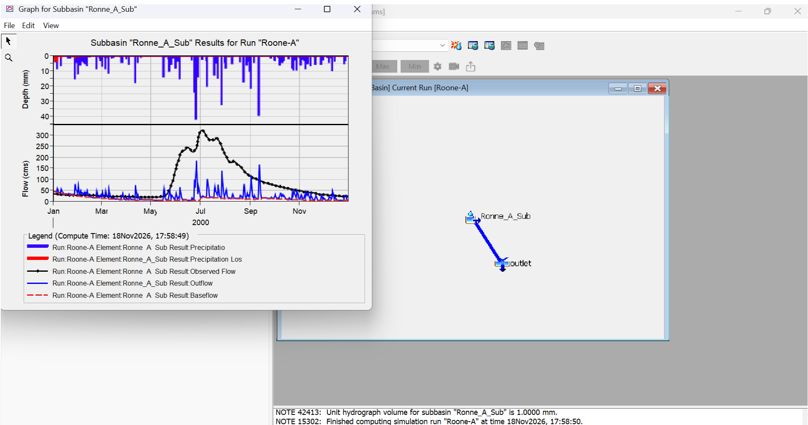
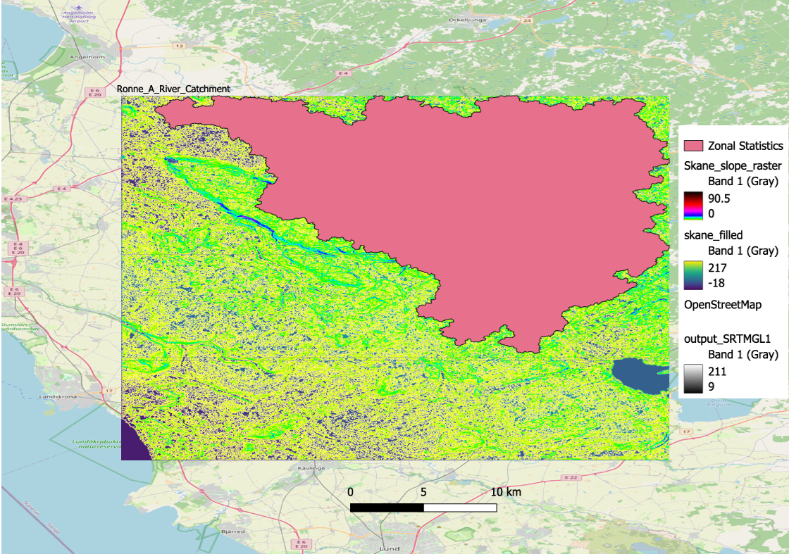

# HEC-HMS Hydrological Modeling: Rönne å Basin, Sweden

## 📌 Project Overview
This project demonstrates a complete hydrological modeling workflow, from GIS catchment delineation to rainfall-runoff simulation and calibration using HEC-HMS. The model simulates the hydrological response of a 619 km² sub-catchment of the Rönne å river (draining to Ängelholm, Sweden) for the year 2000.

## 🛠️ Technical Stack
*   **GIS Preprocessing:** QGIS (GRASS tools for DEM processing, flow accumulation, and catchment delineation).
*   **Data Acquisition:** Python (fetching and cleaning real SMHI hydrological and meteorological data).
*   **Hydrological Modeling:** HEC-HMS (SCS Curve Number, SCS Unit Hydrograph, Muskingum Routing).

## ⚙️ Methodology
1. **Catchment Parameters:** Extracted Area (619 km²), Longest Flow Path (37.1 km), and Mean Slope (3.31°) using a 30m SRTM DEM in QGIS.
2. **Meteorological Input:** Processed daily precipitation data from SMHI Station 63010 (Gillastig).
3. **Model Configuration:** 
   *   **Loss Method:** SCS Curve Number (CN = 95).
   *   **Transform Method:** SCS Unit Hydrograph (Lag Time = 1080 mins).
   *   **Baseflow:** Recession method.
4. **Calibration:** Compared simulated outflow against observed daily streamflow data from SMHI Station 2357 (Klippan).

## 📊 Results & Data Limitations
The model successfully captured the **timing** of the extreme flood event in late June 2000. 

*Blue line = Simulated Flow | Black line = Observed Flow*

*   **Simulated Peak:** 184.7 m³/s (26 June 2000)
*   **Observed Peak:** 323.0 m³/s (04 July 2000)

**The "Why" (Data Limitation):** The model underestimates the peak flow and shows a flashier response because daily precipitation data (24-hour interval) smears short, intense convective storms over a full day. To improve accuracy in future iterations, hourly precipitation data should be used to better resolve the catchment's quick response time.

### 🗺️ Catchment Delineation

